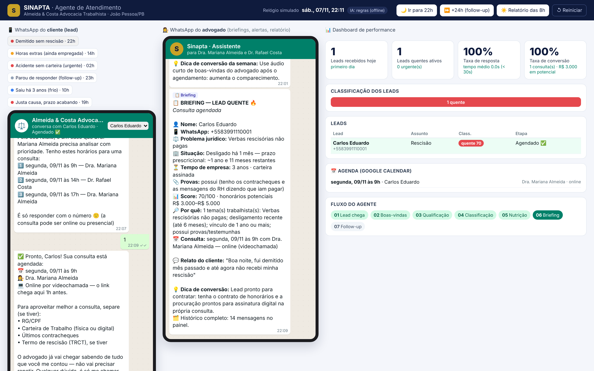

# Sinapta · Agente de Atendimento para Advocacia Trabalhista

Implementação do **Agente de Atendimento** descrito na apresentação *"Ecossistema Comercial para Advocacia"* da Sinapta, configurado para um escritório **trabalhista** fictício (*Almeida & Costa Advocacia Trabalhista*, João Pessoa/PB). Inclui um **simulador local de WhatsApp** para demonstrar o atendimento de ponta a ponta.



## Jeito mais rápido: abrir o arquivo (sem instalar nada)

Baixe **[`dist/sinapta-demo.html`](dist/sinapta-demo.html)** e abra com dois cliques. O agente inteiro roda dentro do navegador, sem servidor e sem internet. Para regenerar o arquivo:

```bash
npm i -D esbuild && npm run build:standalone
```

## Como rodar com servidor (Node.js 20+, sem dependências)

```bash
npm start
```

Abra **http://localhost:3000**. Outros comandos:

```bash
npm run demo
```

```bash
npm test
```

`npm run demo` roda as conversas no terminal e mostra a classificação, o briefing, o relatório das 8h e os follow-ups.

## O que a demo mostra

A tela tem três painéis:

| Painel | O que é |
|---|---|
| 📱 **WhatsApp do cliente** | Você digita como se fosse o trabalhador, ou clica num **cenário pronto** |
| 👩‍⚖️ **WhatsApp do advogado** | Recebe **briefings**, **alertas de urgência**, **transferências** e o **relatório diário das 8h** |
| 📊 **Dashboard** | Leads do dia, quentes ativos, taxa de resposta, conversão, classificação, agenda e etapa do fluxo |

Botões do topo: **🌙 Ir para 22h** (lead fora do horário), **⏩ +24h** (dispara follow-ups), **☀️ Relatório das 8h**, **↺ Reiniciar**.

Cenários prontos:

| Cenário | Resultado esperado |
|---|---|
| Demitido sem rescisão, 22h | 🔥 Quente → consulta agendada + briefing |
| Horas extras, ainda empregada | 🌤️ Morno → pergunta sobre valor (resposta ética) → consulta presencial |
| Acidente sem carteira, 2h da manhã | 🔥 Quente + 🚨 urgente → alerta imediato → pede humano → transferência |
| Parou de responder | Follow-up automático em 24h, 48h e 7 dias |
| Saiu há 3 anos | ❄️ Frio (prescrição) → explicação transparente → nutrição |
| Justa causa, 1 ano e 10 meses | 🔥 Quente + 🚨 prazo prescricional crítico |

## Fluxo do agente (slide 4)

1. **Lead chega** no WhatsApp (webhook da Evolution API)
2. **Boas-vindas** personalizadas (bom dia/boa noite, aviso de atendimento 24h fora do expediente)
3. **Qualificação**, uma pergunta por vez: nome → o que aconteceu → ainda trabalha? → há quanto tempo saiu → tempo de empresa → carteira assinada → provas. O agente **não repete perguntas**: se o lead já contou na primeira mensagem ("fui demitido mês passado e não recebi a rescisão"), ele pula essas etapas.
4. **Classificação automática** em quente/morno/frio (`src/agent/classify.js`), considerando o tipo de caso, o **prazo prescricional de 2 anos** (art. 7º, XXIX, CF), o tempo de vínculo, as provas e a intenção de contratar
5. **Nutrição por perfil**: conteúdo educativo sobre o direito em questão (`src/agent/nurture.js`), checklist de documentos e aviso de prazo
6. **Agenda e briefing**: oferece 3 horários (mock do Google Calendar), confirma e envia ao advogado o briefing com nome, problema jurídico, urgência, score, honorários potenciais, relato e dica de conversão
7. **Follow-up automático** em 24h, 48h e 7 dias. É cancelado quando o lead responde, e quem pediu para sair (opt-out) não recebe mais nada

Regras éticas (Código de Ética da OAB / Provimento 205/2021): o agente não promete resultado, não informa honorários, não dá parecer definitivo, oferece um humano sempre que pedirem e se identifica como assistente virtual. O system prompt completo está em `src/agent/prompt.js`.

## Arquitetura: produção × demo local (slide 6)

| Stack da apresentação | Nesta implementação |
|---|---|
| **Evolution API** (WhatsApp) | `POST /webhook/evolution` aceita o payload `messages.upsert`; `src/channels/evolution.js` envia via `/message/sendText` quando `EVOLUTION_API_URL` está configurada |
| **n8n** (orquestração) | `src/agent/flow.js`, uma máquina de estados equivalente ao workflow |
| **Gemini Flash / Pro** | `src/llm/gemini.js`: Flash para respostas livres e extração, Pro como fallback |
| **Claude** (briefings) | `src/llm/claude.js`: análise do caso no briefing |
| **Supabase** | `src/store.js` (JSON em `data/`) + `db/schema.sql`, pronto para o Supabase |
| **Google Calendar** | `src/calendar.js` (horários mock com 2 advogados) |
| Relatório das 8h / Dashboard | `src/report.js` |

**Sem chaves de API, o agente funciona 100% offline** (motor de regras em PT-BR em `src/agent/extract.js`). Com as chaves, a IA entra automaticamente em três pontos: extração quando as regras não entendem, respostas fora do roteiro e análise técnica no briefing. Se a IA cair, o fluxo continua por regras (contingência do slide 10).

```bash
export GEMINI_API_KEY=...
export ANTHROPIC_API_KEY=...
npm start
```

Variáveis opcionais: `CLAUDE_MODEL`, `GEMINI_FLASH_MODEL`, `GEMINI_PRO_MODEL`, `EVOLUTION_API_URL`, `EVOLUTION_API_KEY`, `EVOLUTION_INSTANCE`, `PORT`, `DATA_FILE`, `ESCRITORIO_TZ` (padrão `America/Recife`).

Para testar o webhook como se fosse a Evolution API:

```bash
curl -X POST localhost:3000/webhook/evolution -H 'content-type: application/json' -d '{"event":"messages.upsert","instance":"escritorio","data":{"key":{"remoteJid":"5583999990000@s.whatsapp.net","fromMe":false},"pushName":"Marcos","message":{"conversation":"Oi, fui demitido ontem e não me pagaram nada"}}}'
```

## Base de conhecimento: CLT

O agente usa o texto oficial da **CLT** ([planalto.gov.br](https://www.planalto.gov.br/ccivil_03/decreto-lei/del5452compilado.htm)) como base de conhecimento:

- **Briefing ao advogado:** seção "📚 Base legal (CLT)" com os artigos do tema do lead (ex.: rescisão → art. 477, §§ 6º e 8º; justa causa → art. 482; gestante → art. 391-A) e o art. 11 (prescrição) quando o lead já saiu da empresa.
- **Cliente pergunta "o que diz a lei?"**: o agente responde com o trecho do artigo e avisa que é um texto informativo.
- **Mensagem educativa:** cita o artigo correspondente.
- **IA (quando configurada):** os artigos relevantes vão como contexto no prompt, e a IA só cita artigos que estão nesse contexto.

Importação (separa o texto em artigos, remove o texto revogado/tachado e as notas de redação):

```bash
npm run ingest:clt
```

Se o download falhar, salve a página no navegador (Ctrl+S → "Página da Web, somente HTML") e rode:

```bash
node scripts/ingest-clt.js caminho/para/del5452compilado.htm
```

O resultado vai para `src/knowledge/clt-data.js`. O topo da demo mostra "📚 CLT: N artigos" (ou "não importada", caso em que o agente funciona sem citar artigos).

**Texto atualmente importado:** 850 artigos vigentes (os números ausentes entre 1 e 922 são revogados ou vetados). Origem: página oficial `del5452compilado.htm` do Planalto, na cópia byte a byte salva em 18/06/2026 pelo projeto [Pantani/jusRAG](https://github.com/Pantani/jusRAG) (`data/seed/labor_clt/_source/planalto_del5452compilado.html`, SHA-256 `4a549cb45e200d1408ca20aabe59422f81e1f6305133cfc2b9827224e7bb7d4d`), porque o site do Planalto recusa conexões vindas do servidor em nuvem usado aqui. Alterações na CLT publicadas depois dessa data não estão incluídas: para atualizar, rode `npm run ingest:clt` numa máquina que acesse o Planalto.

## Personalizar para outro escritório

Edite `src/config.js` (nome, advogados, OAB, endereço, horários de consulta) e, se quiser, os textos de nutrição em `src/agent/nurture.js`.

## Estrutura

```
src/
  server.js            servidor HTTP (simulador + API + webhook Evolution)
  api.js               rotas e "cron" de follow-up/relatório (usado pelo servidor e pela versão standalone)
  config.js            dados do escritório e variáveis de ambiente
  agent/flow.js        fluxo do atendimento (máquina de estados)
  agent/extract.js     extração de dados do texto (PT-BR)
  agent/classify.js    score quente/morno/frio + urgência + prescrição
  agent/briefing.js    briefing e alerta para o advogado
  agent/nurture.js     conteúdo educativo, documentos, dicas de conversão
  agent/prompt.js      system prompt (LLM)
  knowledge/           CLT: importador (parse-clt.js), busca/citações (clt.js), dados (clt-data.js)
  llm/                 roteador Gemini/Claude com fallback offline
  report.js            relatório diário 8h + métricas do dashboard
  calendar.js          agenda (mock Google Calendar)
  channels/evolution.js
public/                simulador web (WhatsApp do lead, do advogado e dashboard)
web/standalone.js      entrada da versão que roda só no navegador
dist/sinapta-demo.html demo em arquivo HTML único (gerado por npm run build:standalone)
scripts/demo.js        demo no terminal
test/                  testes (node --test)
db/schema.sql          schema para Supabase
```
